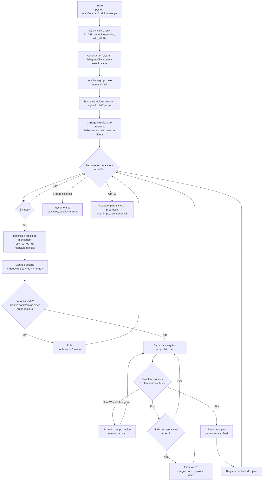

# Robô baixa vídeos do Telegram

Baixa os vídeos de um grupo do Telegram (com tópicos de fórum), usando a
sua própria conta via [Telethon](https://docs.telethon.dev/), e salva cada
vídeo numa pasta com o nome do tópico de onde ele veio.

## Como funciona

- Localiza o grupo pelo nome visível e lista os tópicos do fórum.
- Percorre o histórico do grupo e baixa só as mensagens que são vídeo
  (inclusive vídeos enviados como arquivo/documento).
- Salva em `~/Vídeos/<nome do tópico>/<id da mensagem>_<nome do arquivo>`.

## Fluxo do código



O mesmo fluxo, em palavras:

1. **Configuração** — lê o `.env`, valida `ID_API` (convertendo para
   número) e `API_HASH`, e define grupo, pasta de destino e limite.
2. **Conexão** — abre a sessão do Telegram com o Telethon (pede login
   só se ainda não houver sessão salva).
3. **Preparação** — localiza o grupo pelo nome, busca os tópicos do
   fórum e carrega o registro de vídeos já baixados.
4. **Varredura** — percorre o histórico; para cada mensagem que é
   vídeo, identifica o tópico e monta a pasta/nome de destino.
5. **Verificação** — se o vídeo já foi baixado completo, pula. Senão,
   baixa para um `.part`, confere o tamanho e só então vira o arquivo
   final e entra no registro.
6. **Falhas** — `FloodWait` espera o tempo que o Telegram pedir; outros
   erros têm até 3 tentativas, e um vídeo que falha não interrompe os
   demais.
7. **Encerramento** — no fim (ou num `Ctrl+C`), mostra o resumo com
   baixados, pulados e erros, com o progresso salvo para a próxima
   execução continuar de onde parou.

## O que esta versão corrige

- **Não baixa tudo de novo ao rodar novamente.** Antes de baixar, ele
  confere se o arquivo já existe completo no disco e consulta um registro
  de progresso (`.baixados.json`, salvo junto dos vídeos). O que já foi
  baixado é pulado.
- **Interromper não quebra nada.** O download vai primeiro para um arquivo
  temporário `.part` e só vira o arquivo final depois de concluído e com o
  tamanho conferido. Se você apertar `Ctrl+C` (ou o processo for
  interrompido), o parcial é apagado, o progresso fica salvo e, ao rodar
  de novo, ele continua de onde parou — sem traceback na tela.
- **Um vídeo com erro não para os outros.** Cada vídeo tem até 3
  tentativas; o limite do Telegram (`FloodWait`) é respeitado esperando o
  tempo pedido. Se um vídeo falhar de vez, ele é anotado como erro e o
  robô segue para o próximo.
- **`ID_API` tratado como número**, como o Telethon exige, com mensagem
  clara se o `.env` estiver errado.
- **Configuração pelo `.env`**: grupo, pasta de destino, limite de
  mensagens e nome da sessão podem mudar sem mexer no código.
- **Dependências corrigidas** no `pyproject.toml`: sai o pacote errado
  `dotenv` e o pacote sem relação `functions`; entra `python-dotenv`.

## Configuração

1. Crie suas credenciais em https://my.telegram.org/apps
   (`api_id` e `api_hash`).
2. Copie o modelo de configuração e preencha:

   ```bash
   cp .env.example .env
   ```

   ```ini
   ID_API=seu_id_numerico
   API_HASH=seu_hash
   ```

   Opcionais no `.env`: `NOME_GRUPO`, `PASTA_VIDEOS`,
   `LIMITE_MENSAGENS` (vazio = todo o histórico) e `NOME_SESSAO`.

3. Instale as dependências:

   ```bash
   poetry install
   # ou
   pip install telethon python-dotenv
   ```

## Como rodar

```bash
python uteis/funcoes/cod_funcoes.py
```

Na primeira vez, o Telegram pede seu telefone, o código que chega no
aplicativo e, se você tiver, sua senha de verificação em duas etapas.
Isso cria o arquivo de sessão local.

## Segurança — leia antes de compartilhar qualquer coisa

- **Nunca** suba o arquivo `.env` nem o arquivo de sessão (`*.session`)
  para o GitHub. Os dois já estão no `.gitignore`.
- O arquivo de sessão funciona como uma **senha da sua conta**: quem tiver
  ele entra sem precisar de código. Guarde só na sua máquina.
- Nunca cole em chats, prints ou issues: seu `API_HASH`, códigos de login
  recebidos por SMS/aplicativo ou sua senha de duas etapas.
- Se desconfiar que sua sessão vazou, encerre as outras sessões em
  Telegram → Configurações → Dispositivos.
