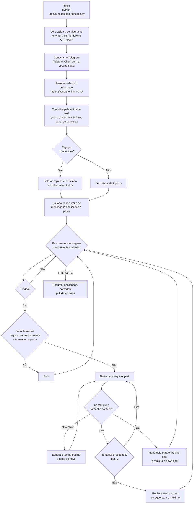

# Robô baixa vídeos do Telegram

Baixa vídeos de **grupos comuns, grupos com tópicos (fórum), canais e
conversas privadas** do Telegram, usando a sua própria conta via
[Telethon](https://docs.telethon.dev/). Os arquivos ficam organizados
em pastas por destino e, quando houver, por tópico.

## Fluxo do código



Em palavras: o programa pergunta (ou recebe por argumento) **de onde**
baixar, **quantas mensagens analisar** e **onde salvar**; identifica o
tipo do destino pela entidade do Telegram; baixa cada vídeo para um
arquivo temporário; e só promove a arquivo final o que terminou e
conferiu — pulando o que já foi baixado.

## Requisitos

- Python 3.12
- [Poetry](https://python-poetry.org/) para gerenciar as dependências
- Uma conta do Telegram e as credenciais de API dela
  (https://my.telegram.org/apps)

## Instalação

```bash
poetry install
```

## Configuração (credenciais)

1. Copie o modelo e preencha com as **suas** credenciais:

   ```bash
   cp .env.example .env
   ```

   ```ini
   ID_API=seu_id_numerico
   API_HASH=seu_hash
   ```

2. Opcionais no `.env` (servem como padrão; o terminal pergunta o que
   faltar): `DESTINO` (grupo/canal/conversa padrão; `NOME_GRUPO` é
   aceito por compatibilidade), `PASTA_VIDEOS`, `LIMITE_MENSAGENS` e
   `NOME_SESSAO`.

## Como executar

```bash
poetry run python uteis/funcoes/cod_funcoes.py
```

Sem argumentos, o programa pergunta tudo no terminal, com validação e
chance de corrigir sem fechar. Também dá para informar direto:

```bash
poetry run python uteis/funcoes/cod_funcoes.py \
  --destino "@meugrupo" --limite 500 --pasta ~/Vídeos
```

Argumentos: `--destino`, `--topico` (nome ou ID), `--todos-topicos`,
`--limite` e `--pasta`. Na primeira execução, o Telegram pede telefone,
código (que chega no aplicativo) e, se houver, a senha de verificação
em duas etapas — isso cria o arquivo de sessão local.

## Escolhendo o destino

Aceita: **título** do grupo/canal/conversa, **@usuário**, **link**
(`t.me/nome`, inclusive links internos `t.me/c/...`) ou **ID numérico**.
Digite `listar` na pergunta do destino para escolher entre as suas
conversas por um menu numerado.

O tipo do destino é identificado pela **entidade** do Telethon, não
pelo nome: grupo comum, grupo com tópicos, canal ou conversa privada.
Se houver dois destinos com o mesmo título, o programa **não escolhe
sozinho** — ele mostra as opções para você decidir. Se o destino não
existir ou sua conta não tiver acesso, ele explica e pergunta de novo,
sem encerrar o programa.

## Tópicos (grupos de fórum)

Em grupo com tópicos, o programa lista os tópicos e você escolhe **um**
(pelo número ou pelo nome exato, validado contra os tópicos do grupo)
ou **todos**. Em destinos sem tópicos, essa etapa nem aparece.

## Limite de mensagens

O limite é o número de **mensagens analisadas**, não de vídeos
baixados — uma varredura de 500 mensagens pode render bem menos de 500
vídeos. A leitura é das mensagens **mais recentes para as mais
antigas**. Com um tópico selecionado, o limite conta só as mensagens
daquele tópico; com todos os tópicos (ou sem tópicos), conta o total
varrido no destino. Vazio = analisar todas as acessíveis.

## Organização e duplicidade

Estrutura de pastas:

```text
<pasta escolhida>/
├── <nome do destino>/
│   ├── <nome do tópico>/     (só em grupos com tópicos)
│   │   └── video.mp4
│   └── ...
└── .baixados.json            (registro interno de downloads)
```

- O nome do arquivo é o **nome original** do vídeo — sem prefixo de ID.
- **Duplicidade é pelo nome dentro da pasta**: mesmo nome e mesmo
  tamanho = já baixado, pula. Mesmo nome mas **tamanho diferente** é
  outro vídeo com nome igual: ele é salvo com o ID da mensagem como
  sufixo (ex.: `video_123.mp4`) para não perder nenhum dos dois.
- Um registro interno (`.baixados.json`, por destino + mensagem)
  reforça a regra: vídeo já concluído não é baixado de novo nem se as
  pastas forem reorganizadas. Downloads da estrutura antiga (pastas
  por tópico, sem a pasta do destino) continuam reconhecidos por ele.
- Todo download vai primeiro para um arquivo `.part`; só vira o
  arquivo final depois de terminar e ter o tamanho conferido. Falhou
  ou interrompeu (Ctrl+C)? O parcial é apagado e nada fica marcado
  como concluído — a próxima execução tenta de novo, continuando de
  onde parou. Um vídeo com erro tem até 3 tentativas e não interrompe
  os demais; o limite do Telegram (FloodWait) é respeitado.

**Limitação conhecida:** dois vídeos diferentes com exatamente o
mesmo nome **e** o mesmo tamanho serão tratados como o mesmo arquivo
(nome igual não garante conteúdo idêntico — é o comportamento da
regra por nome).

## Logs

Logs diários em `logs/<AAAA-MM-DD>/app.log` (na raiz do projeto —
pasta ignorada pelo Git). Se a execução atravessar a meia-noite, os
registros novos vão para a pasta do novo dia automaticamente. Níveis:
DEBUG (detalhes técnicos), INFO (andamento e resultados), WARNING
(arquivo já existente, situações contornáveis), ERROR (falha numa
operação) e CRITICAL (erro que encerra o programa). Credenciais,
códigos e sessão **nunca** são registrados.

## Estrutura do projeto

```text
uteis/funcoes/
├── cod_funcoes.py    ponto de entrada (comando de execução)
├── app.py            orquestração (config -> conexão -> execução)
├── configuracao.py   leitura/validação do .env
├── destinos.py       resolução e classificação dos destinos
├── topicos.py        tópicos de grupos de fórum
├── baixador.py       motor de download (não depende do terminal)
├── arquivos.py       pastas, nomes, duplicidade e registro
├── terminal.py       perguntas e seleções no terminal
├── registro.py       logs diários
└── erros.py          exceções próprias do programa
tests/                testes automatizados (pytest, com mocks)
```

Essa separação é o que permite, no futuro, trocar o terminal por uma
interface (desktop/web) reaproveitando o mesmo motor.

## Testes

```bash
poetry run pytest
```

Os testes não acessam o Telegram: usam objetos falsos (mocks) para
validação de entradas, classificação de destinos, caminhos,
duplicidade, arquivos temporários, logs e o motor de download.

## Segurança — leia antes de compartilhar qualquer coisa

- **Nunca** suba o `.env` nem arquivos de sessão (`*.session`) para o
  GitHub; os dois estão no `.gitignore`, assim como `logs/` e os
  arquivos temporários `.part`.
- O arquivo de sessão funciona como uma **senha da sua conta**: quem
  tiver ele entra sem precisar de código. Guarde só na sua máquina.
- Nunca cole em chats, prints ou issues: seu `API_HASH`, códigos de
  login ou sua senha de duas etapas.
- Se desconfiar que sua sessão vazou, encerre as outras sessões em
  Telegram → Configurações → Dispositivos.

## Erros comuns

- **"Configure ID_API/API_HASH no .env"** — falta o `.env` ou ele está
  incompleto; copie do `.env.example`.
- **"ID_API precisa ser um número inteiro"** — o valor no `.env` está
  com letras/espaços errados; use só os dígitos do my.telegram.org.
- **Destino não encontrado** — confira título/@/link/ID, veja se sua
  conta participa do grupo/canal, ou use `listar` no prompt.
- **Programa "parou" no meio** — provavelmente foi Ctrl+C ou queda de
  conexão: rode de novo, ele continua de onde parou.
- **Falta de espaço em disco** — o programa encerra com mensagem
  clara; libere espaço e rode de novo, o que já baixou é aproveitado.
